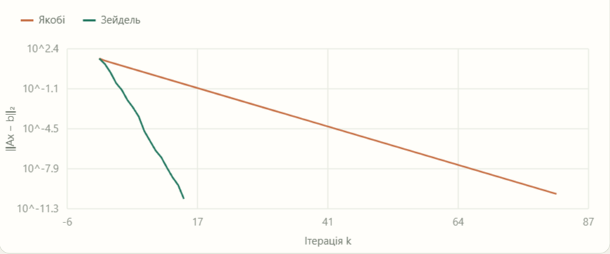
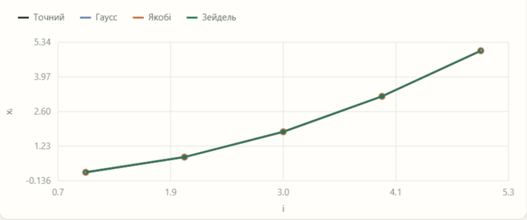
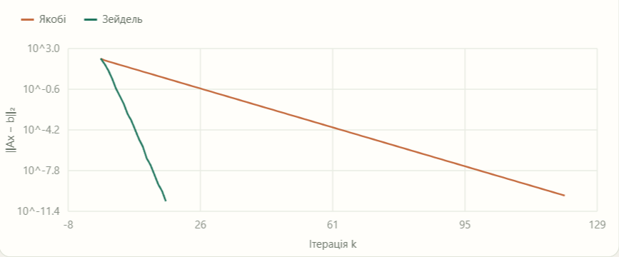
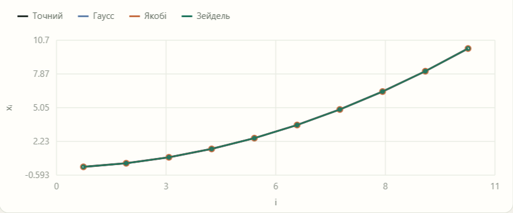
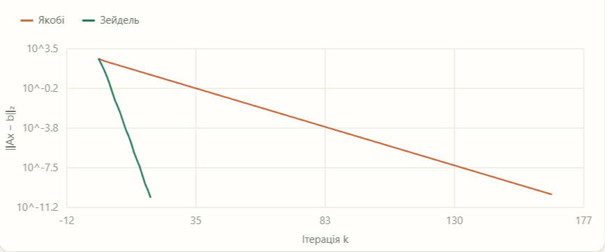
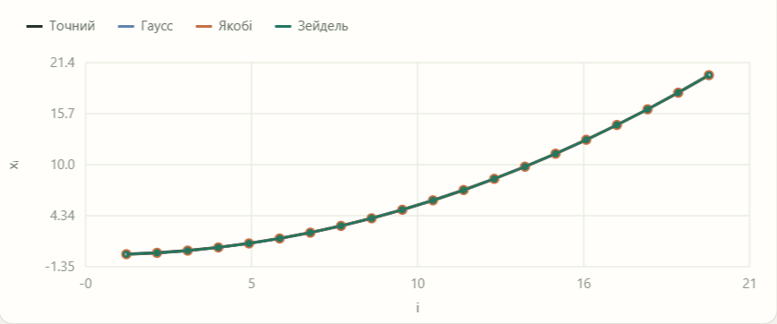
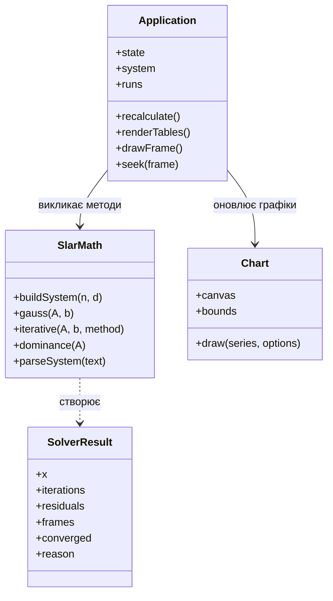
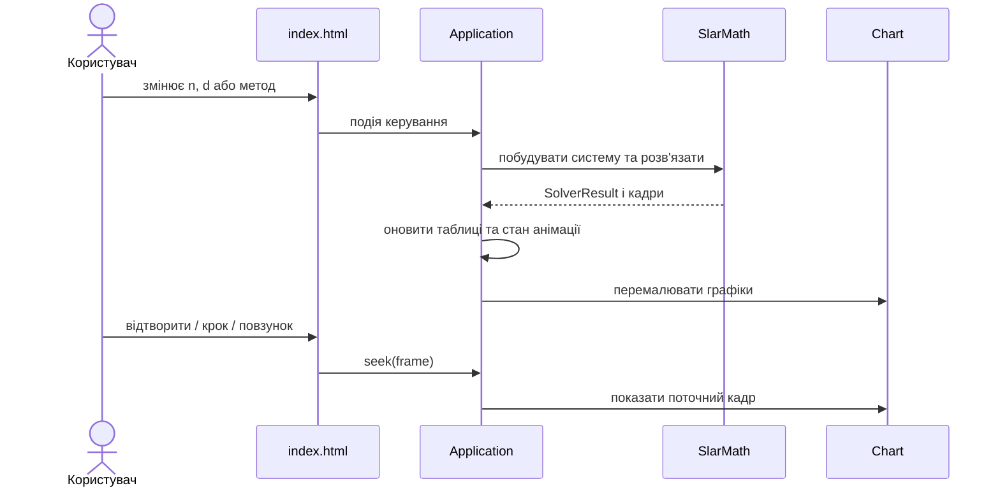

# Лабораторна робота № 2 · JavaScript

**Жуков Михайло Володимирович, варіант № 2.**

Прямі та ітераційні методи розв'язання СЛАР: Гаусс із частковим вибором
головного елемента, Якобі та Зейдель.

## Запуск програми

Відкрийте **index.html** у Chrome або Edge. Сервер, встановлення пакетів
та доступ до інтернету для програми не потрібні. Усі скрипти й стилі локальні.
Стек: JavaScript, HTML/CSS, Canvas API, як у лабораторній роботі № 1.

1. Оберіть n = 5/10/20 та d = 1/0,1.
2. Оберіть метод анімації. Верхні графіки порівнюють усі доступні методи.
3. Натисніть «Відтворити», «Крок» або перемістіть повзунок.
4. За потреби розкрийте «Матриця та власні дані», введіть розширену матрицю
   чи JSON або відкрийте файл. «Варіант 2» повертає початковий генератор.

Зміна n або d також повертає генератор варіанта. Шість нижніх графіків
завжди показують початковий варіант при d = 1, ε = 1e-10.

Приклад ручного введення:

```text
4 1 | 1
2 3 | 2
```

JSON:

```json
{"A": [[4,1],[2,3]], "b": [1,2]}
```

Поле `exact` необов'язкове. Без нього похибка відносно точного розв'язку
не показується. Десятковий роздільник - крапка. Власні системи: 2..50.
Кнопки експорту записують поточну систему JSON та результати CSV.

## Тести та відтворення вимірювань

Потрібен Node.js 20 або новіший. Перевірено на Node.js v24.14.0, Windows 11.
Бібліотек для обчислень і тестів не потрібно.

```text
node --test tests/*.test.js
node scripts/metrics.js
```

Або `npm test` і `npm run metrics`. У PowerShell із забороненими ps1
можна використовувати `npm.cmd test` та `npm.cmd run metrics`.

39 автоматичних тестів: 18 комбінацій методу/n/d, особливі випадки,
розбір даних, історія кадрів та масштабування. Протокол: results/tests.txt.
metrics.js формує 18 рядків CSV/JSON, історії нев'язки, системи та експеримент
з нульовим головним елементом. Час - медіана 7 запусків після 3 прогрівів,
без DOM, графіків та запису кадрів. У браузері показано час одного запуску;
він не зобов'язаний збігатися з вимірюваннями Node.js.

Необов'язкова перевірка браузера (потрібні встановлений Chrome і Playwright):

```text
npm.cmd install --no-save playwright@1.65.1
node scripts/browser-check.js
```

Скрипт відкриває локальний index.html у headless Chrome, перевіряє 28 сценаріїв
і зберігає знімки інтерфейсу та 6 Canvas-графіків у results.

## Методологія розробки

Використано ітеративний підхід Agile, продовжуючи практику лабораторної
роботи № 1. Роботу поділено на перевірювані етапи: вимоги й дані, математичне
ядро, інтерфейс та анімація, тестування й документування. Після кожного етапу
можна перевірити окремий артефакт: технічне завдання, алгоритм, робочу функцію,
інтерфейс або протокол тестів. Такий підхід підходить для цієї програми, бо
графіки й керування можна уточнювати окремо від числових методів.

Основні ризики — числова стійкість, некоректне введення та збіжність
ітерацій. Їх перевіряють контроль малого pivot, валідація системи, попередження
про діагональну перевагу й окремі тести граничних випадків. Перелік вимог
наведено в [технічному завданні](docs/requirements.md).

## Математичні правила

У формулах i,j починаються з 1:

- aᵢⱼ = 1/|i−j|, i≠j; aᵢᵢ = Σⱼ≠ᵢ |aᵢⱼ| + d;
- x*ᵢ = i²/n; b = Ax*;
- початкове наближення x⁽⁰⁾ = 0;
- критерій зупинки ‖Ax−b‖₂ ≤ ε, типово ε = 1e-10;
- похибка ‖x−x*‖∞; ліміт типово 20 000 ітерацій;
- малий pivot: |pivot| ≤ 1e-14 max|aᵢⱼ|.

Відсутність строгої діагональної переваги дає попередження, а не заборону.
Ітерації зупиняються за точністю, лімітом, переповненням або |xᵢ| > 1e100.
GUI допускає ε = 1e-15..1 і цілий ліміт 20 000..100 000.
Гаусс має 0 ітерацій у CSV (прямий метод), у таблиці браузера стоїть риска.

## Файли

| Файл | Призначення |
|---|---|
| index.html, style.css | Розмітка й адаптивний інтерфейс |
| js/math.js | Усі обчислення, перевірки, клас SolverResult |
| js/chart.js | Canvas-графіки, клас Chart, автомасштаб |
| js/app.js | Application: події, анімація, таблиці та експорт |
| scripts/metrics.js | Експерименти Node.js |
| tests/*.test.js | Модульні тести |
| scripts/browser-check.js | Браузерна перевірка та скріншоти |
| docs/ | Технічне завдання, методологія та діаграми |
| results/ | Метрики, протоколи й рисунки |

## Аналітичне тестування та результати

Для кожної комбінації `n = 5, 10, 20` і `d = 1, 0,1` матрицю сформовано за
варіантом № 2, а праву частину перераховано як `b = Ax*`. Ітераційні методи
стартують із нульового вектора й зупиняються при `‖Ax − b‖₂ ≤ 10⁻¹⁰`.
У таблицях наведено медіану часу 7 запусків після 3 прогрівів у Node.js;
час є орієнтовним і залежить від середовища.

### d = 1

| n | Метод | Ітерації | Нев'язка L2 | Похибка L∞ | Час, мс |
|---:|---|---:|---:|---:|---:|
| 5 | Гаусс | — | 3,662e-15 | 8,882e-16 | 0,0204 |
| 5 | Якобі | 81 | 9,032e-11 | 6,754e-12 | 0,1975 |
| 5 | Зейдель | 15 | 3,404e-11 | 6,126e-12 | 0,0132 |
| 10 | Гаусс | — | 1,913e-14 | 1,776e-15 | 0,0364 |
| 10 | Якобі | 121 | 9,196e-11 | 3,404e-12 | 0,0879 |
| 10 | Зейдель | 17 | 2,867e-11 | 6,081e-12 | 0,0153 |
| 20 | Гаусс | — | 1,214e-13 | 1,776e-14 | 0,0469 |
| 20 | Якобі | 165 | 9,777e-11 | 1,956e-12 | 0,3397 |
| 20 | Зейдель | 19 | 4,933e-11 | 5,923e-12 | 0,0383 |

### d = 0,1

| n | Метод | Ітерації | Нев'язка L2 | Похибка L∞ | Час, мс |
|---:|---|---:|---:|---:|---:|
| 5 | Гаусс | — | 0,000e+00 | 8,882e-16 | 0,0098 |
| 5 | Якобі | 688 | 9,859e-11 | 8,367e-12 | 0,2982 |
| 5 | Зейдель | 18 | 9,140e-11 | 4,947e-11 | 0,0078 |
| 10 | Гаусс | — | 1,137e-14 | 3,553e-15 | 0,0143 |
| 10 | Якобі | 1078 | 9,965e-11 | 4,005e-12 | 1,0016 |
| 10 | Зейдель | 19 | 1,585e-11 | 1,968e-12 | 0,0212 |
| 20 | Гаусс | — | 7,614e-14 | 1,243e-14 | 0,0448 |
| 20 | Якобі | 1513 | 9,982e-11 | 2,119e-12 | 2,0735 |
| 20 | Зейдель | 20 | 6,984e-11 | 3,236e-12 | 0,0261 |

Зменшення `d` послабило діагональну перевагу та збільшило число ітерацій
Якобі: для `n = 20` з 165 до 1513. У Зейделя воно зросло з 19 до 20.
У всіх 18 запусків ітераційна нев'язка не перевищила `10⁻¹⁰`, а похибка
розв'язку була меншою за `10⁻⁹`. Гаусс із pivot дав похибки порядку
`10⁻¹⁶…10⁻¹⁴`.

### Графіки

Нижче наведені графіки збіжності та компонентів розв'язку для всіх трьох
розмірів системи при `d = 1`.

| n | Збіжність | Компоненти розв'язку |
|---:|---|---|
| 5 |  |  |
| 10 |  |  |
| 20 |  |  |

### Контрольні перевірки

- `node --test tests/*.test.js`: 39 тестів пройдено, помилок немає.
- `results/browser_checks.json`: 28 браузерних сценаріїв пройдено, помилок JavaScript немає.
- Перевірено нульовий і від'ємний pivot, вироджену систему, нульову діагональ,
  розбіжність, некоректний ввід, перші кроки Якобі/Зейделя та довгі історії графіків.
- У контрольному прикладі без вибору pivot нульовий головний елемент відхиляється;
  з вибором pivot розв'язок збігається з точним.

## Висновок

Реалізовано локальний браузерний застосунок для розв'язання СЛАР трьома
методами. Програма порівнює точність, збіжність і час, підтримує власні дані,
експорт результатів, графіки та покрокову анімацію. Для заданого варіанта всі
шість систем пройшли критерії приймання. Результати для довільних систем без
діагональної переваги залежать від їхніх властивостей і не гарантуються.

## Обмеження

JavaScript Number - подвійна точність. Дуже погано обумовлені системи
потребують окремого аналізу. Абсолютна нев'язка залежить від масштабу даних.
Історія ітерацій зберігається в пам'яті; великий власний ліміт може затримати
інтерфейс під час обчислення. Кадри відтворюються без повторного розв'язування.
Нуль для логарифмічної осі відображається на рівні 1e-300.

## Проєктування логіки

Алгоритми описано блок-схемами. Метод Гаусса на кожному кроці обирає рядок із
найбільшим за модулем елементом поточного стовпця, переставляє рядки та виконує
виключення. Якобі обчислює новий вектор із попереднього, а Зейдель одразу
використовує вже оновлені компоненти. Окрема схема перевіряє строгу діагональну
перевагу.

| Алгоритм | Блок-схема |
|---|---|
| Гаусс із вибором pivot | [docs/gauss.png](docs/gauss.png) |
| Якобі | [docs/jacobi.png](docs/jacobi.png) |
| Зейдель | [docs/seidel.png](docs/seidel.png) |
| Перевірка діагональної переваги | [docs/dominance.png](docs/dominance.png) |

Основні ідентифікатори: `A` — матриця коефіцієнтів, `b` — права частина,
`exact` — точний розв'язок, `M` — розширена матриця, `p` — індекс pivot,
`x` та `old` — поточний і попередній вектори. `SolverResult` зберігає
результат методу й історію кадрів; `Application` керує інтерфейсом, а `Chart`
малює графіки.

## Моделювання взаємодії: UML

Діаграма класів показує залежності інтерфейсного контролера від обчислювального
модуля, результату розв'язання та Canvas-графіків.



Послідовність показує перерахунок після зміни параметрів та відтворення
збережених кадрів.



Растрові копії діаграм: [класи](docs/classes.png) і
[послідовність](docs/sequence.png).
